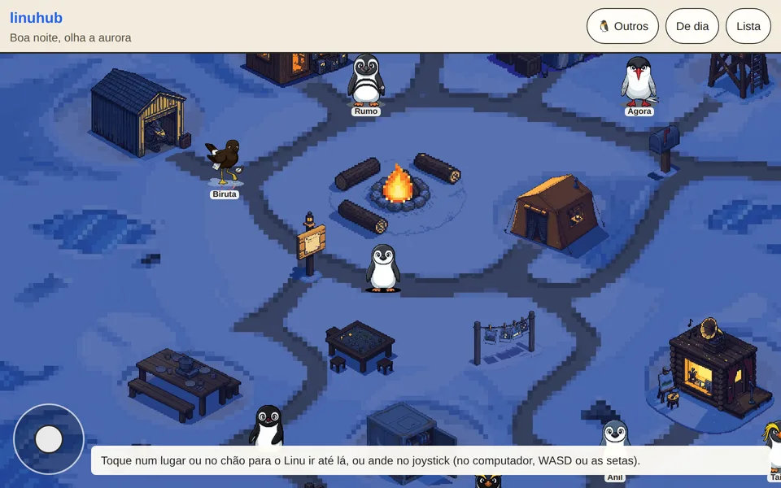
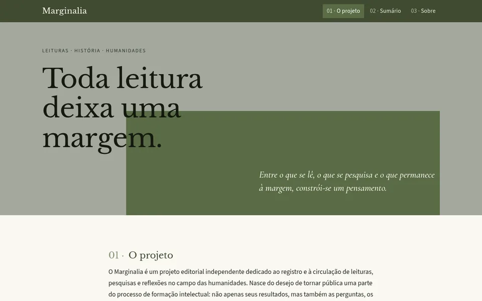
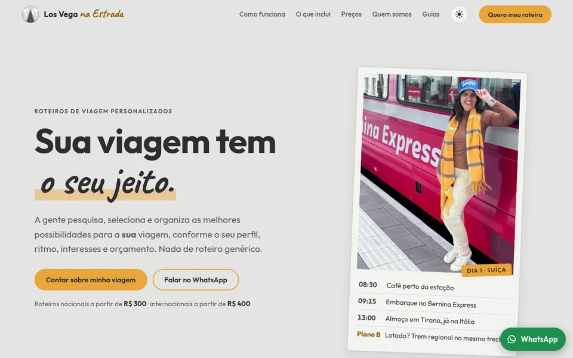

# Oi, eu sou o Matheus

Matheus Vega, de Brasília. Estudo Ciência da Computação no CEUB e faço sites e aplicativos sob medida pelo
[Linu Sites](https://sites.linupedia.com.br). Sempre gostei de idiomas, e foi daí que nasceu o meu projeto principal,
a LinuPedia.

O pinguim aqui do lado é o Linu, um pinguim-de-barbicha que sai da Antártica e viaja até o país da língua que você
estuda. Ele aparece em quase tudo o que eu faço.

## LinuPedia

Começou como um app de idiomas e virou uma enciclopédia jogável: **197 idiomas**, do romeno ao tupi antigo e ao
klingon, e **39 áreas do conhecimento**, cada uma com a sua trilha, os seus exercícios e o Linu vestido a caráter
(jaleco na Química, toga no Direito). Funciona offline, é gratuito e não tem propaganda, e cada fato vem com a fonte.

Feito com Expo e React Native, em TypeScript, com o banco SQLite no próprio aparelho. Abre no navegador e instala
como app: **[linupedia.com.br](https://linupedia.com.br)**.

## Linu Sites

O estúdio em que faço sites e aplicativos web para outras pessoas, do site de apresentação à ferramenta com painel e
login. Eu desenho, programo, publico e cuido do servidor. Alguns que estão no ar:

<table>
  <tr>
    <td width="33%" valign="top">
      
      
<b><a href="https://v2tech.app.br">V²Tech COMBUSTÍVEL</a></b> 
      Confere se o preço do diesel, da gasolina ou do etanol cobrado pelo fornecedor faz sentido, cruzando dados da
      Petrobras, da ANP e da Receita.

    </td>
    <td width="33%" valign="top">
      
      
<b><a href="https://marginalia.blog.br">Marginalia</a></b> 
      Revista independente de História e humanidades, com notas na margem, referência ABNT pronta para copiar e um
      painel para a autora escrever.

    </td>
    <td width="33%" valign="top">
      
      
<b><a href="https://losveganaestrada.com.br">Los Vega na Estrada</a></b> 
      Roteiros de viagem personalizados: o cliente conta sobre a viagem e já vê o valor, e o pedido chega num painel
      com a resposta pronta pelo WhatsApp.

    </td>
  </tr>
</table>

Os outros (Iconvet, Administração Judicial Oriente, Dojo Legacy e Ômega Imóveis) e como cada um foi feito estão no
[portfólio](https://sites.linupedia.com.br/#projetos).

## Projetos de estudo, com o código aberto

Trabalhos da disciplina de Desenvolvimento de Interfaces que eu transformei em sites inteiros:

- **[Café Aurora](https://github.com/Seiabras/cafe-aurora)**: cafeteria cyberpunk que não existe, em três versões
  (CSS puro, Bootstrap e Tailwind). Hoje é o site do simulador de preço do Linu Sites.
  [cafe.linupedia.com.br](https://cafe.linupedia.com.br)
- **[Fotografia do Cerrado](https://github.com/Seiabras/fotografia-do-cerrado)**: empresa fictícia de fotografia de
  fauna, com a paleta tirada do bioma e o contraste de cada cor medido pela WCAG 2.2.
  [cerrado.linupedia.com.br](https://cerrado.linupedia.com.br)
- **[Abelhas sem Ferrão](https://github.com/Seiabras/abelhas-sem-ferrao)**: para quem nunca ouviu falar das abelhas
  nativas do Brasil. Nasceu de um exercício de Design Thinking.
  [abelhas.linupedia.com.br](https://abelhas.linupedia.com.br)

## Como eu trabalho

- Servidor próprio na Oracle Cloud, atrás do Caddy, e cada push na `main` publica sozinho pelo GitHub Actions.
- Node.js sem dependências sempre que dá: menos coisa para quebrar e para atualizar.
- Acessibilidade conferida, não presumida: contraste medido, foco visível, leitor de tela e “menos movimento”.
- Tudo servido pelo próprio endereço, sem CDN, com política de conteúdo (CSP) fechada.
- Nada de visual genérico: o Linu em pixel art, fontes escolhidas por um motivo e capturas reais no lugar de
  ilustração de banco.

No dia a dia: TypeScript, JavaScript, React Native e Expo, Node.js, SQLite, HTML e CSS, e Python para os scripts.
Comecei em C, em Programação 1 na UFRJ ([Prog1-UFRJ](https://github.com/Seiabras/Prog1-UFRJ)).

## Contato

Para pedir um site ou conversar sobre a LinuPedia: [contato@linupedia.com.br](mailto:contato@linupedia.com.br) ou
pelo [site do Linu Sites](https://sites.linupedia.com.br/#contato).

<b>In English</b>

 

I'm Matheus Vega, from Brasília, Brazil. I study Computer Science at CEUB and build custom websites and web apps
through [Linu Sites](https://sites.linupedia.com.br/en/), my studio.

My main project is [LinuPedia](https://linupedia.com.br): a free, ad-free study app that works offline. It started
as a language app and grew into a playable encyclopedia, with 197 languages and 39 fields of knowledge, guided by
Linu, a pixel-art chinstrap penguin. Built with Expo and React Native, in TypeScript, with SQLite on the device.

